<!-- ============ $ whoami ============ -->
<p align="center">
  
</p>

<p align="center">
  <a href="https://www.linkedin.com/in/alvaromiguel01g/"></a>
  <a href="mailto:alvaromgueiros@gmail.com"></a>
  <a href="https://homeeasy-bd496.web.app"></a>
  
  
</p>

<br/>

<!-- ============ 01. sobre_mim() ============ -->


[](https://git.io/typing-svg)

<div align="justify">

Sou desenvolvedor de software com **mais de 3 anos de experiência** construindo, modernizando e sustentando aplicações em produção nos setores corporativo, de logística e de saúde pública.

Meu foco está em `Backend` e `Full Stack`, da análise das regras de negócio até APIs, integrações, interfaces, bancos de dados e entrega. Trabalhei com sistemas legados, aplicações usadas por **mais de 7.000 usuários** e plataformas de rastreamento com contas de até **~5.000 dispositivos**.

Gosto de investigar problemas, entender como as peças de um sistema se conectam e construir soluções simples, confiáveis e fáceis de evoluir.

</div>

```diff
+ APIs e integrações com Java/Spring Boot, NestJS e C#/.NET
+ Sistemas em produção para saúde pública, logística e corporativo
+ Aberto a desafios de Backend e Full Stack
- Bugs em produção (investigando, sempre)
```

<br clear="right"/>
<br/>

<!-- ============ 02. tecnologias() ============ -->

<p align="center">
  <br/>
  <br/>
  
</p>

<p align="center"><sub>Clean Architecture · SOLID · DDD · Testes unitários e E2E · Jest · Swagger / OpenAPI · SQL Server · PostGIS · Otimização SQL · Sustentação em produção</sub></p>

<br/>

<!-- ============ 03. experiencia() ============ -->

```yaml
- empresa: DIMASTEC
  cargo: Desenvolvimento Full Stack
  periodo: abr/2025 — ago/2026
  destaques:
    - Backend MyDhas e integrações Saturno em Java 21 + Spring Boot
    - Modernização em C#/.NET e serviços em Node.js, NestJS e TypeScript
    - Dashboards React/TypeScript para mais de 7.000 usuários
    - SQL, Redis, Kafka, AWS, Docker e Kubernetes em produção

- empresa: Liga Labs / UPE  # bolsista, convênio UFAPE
  cargo: Desenvolvimento Full Stack
  periodo: abr/2026 — ago/2026
  destaques:
    - SISTERS, usado por hospitais de PE na terapia renal substitutiva
    - APIs NestJS + TypeORM + PostgreSQL com Clean Architecture e DDD
    - React/TypeScript, testes unitários e E2E, Swagger/OpenAPI
    - Módulo de documentos com AWS S3, permissões e exclusão lógica

- empresa: Show Tecnologia / Omnilink
  cargo: Desenvolvimento Full Stack
  periodo: mai/2023 — abr/2025
  destaques:
    - Responsável técnico pela evolução do Omnicarga
    - APIs e telas de logística, cercas geográficas e monitoramento
    - Evolução para a CEABS e internacionalização para a China
    - Otimização SQL e pipelines com GitHub Actions e Docker
```

<br/>

<!-- ============ 04. projetos() ============ -->

> **🏠 HomeEasy** — marketplace de serviços locais que conecta clientes a profissionais. Nasceu como meu TCC no IFPE e estou reconstruindo como produto web e mobile: backend em **NestJS, TypeORM e PostgreSQL/PostGIS** com autenticação JWT, busca geográfica de profissionais e fluxos de solicitações e propostas.
> <br/>`NestJS` `TypeScript` `PostgreSQL/PostGIS` `Angular` `React Native` · [aplicação publicada](https://homeeasy-bd496.web.app) · [repositório](https://github.com/AlvaroMGueiros/HomeEasy-1)

<p align="center">
  <a href="https://github.com/AlvaroMGueiros/kanban-api"><picture><source media="(prefers-color-scheme: dark)" srcset="https://raw.githubusercontent.com/AlvaroMGueiros/AlvaroMGueiros/output/repo-1-dark.svg?v=2" /><source media="(prefers-color-scheme: light)" srcset="https://raw.githubusercontent.com/AlvaroMGueiros/AlvaroMGueiros/output/repo-1.svg?v=2" /></picture></a>
  <a href="https://github.com/AlvaroMGueiros/HomeEasy-Mobile"><picture><source media="(prefers-color-scheme: dark)" srcset="https://raw.githubusercontent.com/AlvaroMGueiros/AlvaroMGueiros/output/repo-2-dark.svg?v=2" /><source media="(prefers-color-scheme: light)" srcset="https://raw.githubusercontent.com/AlvaroMGueiros/AlvaroMGueiros/output/repo-2.svg?v=2" /></picture></a>
  <a href="https://github.com/AlvaroMGueiros/Korp_Teste_AlvaroMiguel"><picture><source media="(prefers-color-scheme: dark)" srcset="https://raw.githubusercontent.com/AlvaroMGueiros/AlvaroMGueiros/output/repo-3-dark.svg?v=2" /><source media="(prefers-color-scheme: light)" srcset="https://raw.githubusercontent.com/AlvaroMGueiros/AlvaroMGueiros/output/repo-3.svg?v=2" /></picture></a>
  <a href="https://github.com/AlvaroMGueiros/fullstack-integration-challenge"><picture><source media="(prefers-color-scheme: dark)" srcset="https://raw.githubusercontent.com/AlvaroMGueiros/AlvaroMGueiros/output/repo-4-dark.svg?v=2" /><source media="(prefers-color-scheme: light)" srcset="https://raw.githubusercontent.com/AlvaroMGueiros/AlvaroMGueiros/output/repo-4.svg?v=2" /></picture></a>
</p>

<br/>

<!-- ============ 05. formacao() ============ -->

```diff
@@ formação @@
+ Bacharelado em Ciência da Computação — UFAPE (2022 — conclusão prevista em dez/2026)
+ Técnico em Informática — IFPE (concluído em 2020)

@@ aprendendo agora @@
! Arquitetura de software, Java/Spring Boot e sistemas distribuídos
! IA generativa como apoio, com revisão de código, testes e entendimento da solução

@@ reconhecimento @@
+ 🏆 Super Destaque em Transparência — Grupo Show Tecnologia (out/2024)
```

<p align="center">
  <a href="https://verify.skilljar.com/c/f2tuzheed788"></a>
  <a href="https://verify.skilljar.com/c/ztpirnd4r2zy"></a>
  
  <a href="https://www.credly.com/badges/93c973b8-a572-48b8-99e2-cd0090ed8868"></a>
</p>

<br/>

<!-- ============ 06. estatisticas() ============ -->

<p align="center">
  <picture><source media="(prefers-color-scheme: dark)" srcset="https://raw.githubusercontent.com/AlvaroMGueiros/AlvaroMGueiros/output/stats-dark.svg?v=2" /><source media="(prefers-color-scheme: light)" srcset="https://raw.githubusercontent.com/AlvaroMGueiros/AlvaroMGueiros/output/stats.svg?v=2" /></picture>
  <picture><source media="(prefers-color-scheme: dark)" srcset="https://raw.githubusercontent.com/AlvaroMGueiros/AlvaroMGueiros/output/langs-dark.svg?v=2" /><source media="(prefers-color-scheme: light)" srcset="https://raw.githubusercontent.com/AlvaroMGueiros/AlvaroMGueiros/output/langs.svg?v=2" /></picture>
</p>

<p align="center">
  
</p>

<br/>

<!-- ============ 07. contribuicoes() ============ -->

<picture>
  <source media="(prefers-color-scheme: dark)" srcset="https://raw.githubusercontent.com/AlvaroMGueiros/AlvaroMGueiros/output/code-contribution-graph-dark.svg?v=2" />
  <source media="(prefers-color-scheme: light)" srcset="https://raw.githubusercontent.com/AlvaroMGueiros/AlvaroMGueiros/output/code-contribution-graph.svg?v=2" />
  
</picture>

<!-- ============ exit ============ -->
<p align="center">
  
</p>
